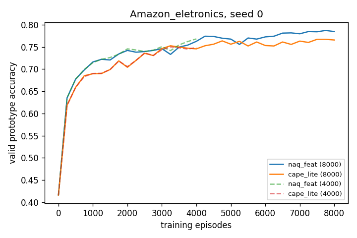

# T04 summary — seed and training-length robustness

LR test accuracy (%), 500 fixed test tasks. std는 seed 3개의 표본 표준편차(ddof=1).

## (a) seed별

| dataset | arm | seed | 1s LR | 5s LR | query_purity | best ep |
|---|---|---|---|---|---|---|
| Amazon_eletronics | naq_feat | 0 | 74.58 | 87.44 | 0.646 | 4000 |
| Amazon_eletronics | naq_feat | 1 | 74.69 | 87.44 | 0.649 | 4000 |
| Amazon_eletronics | naq_feat | 2 | 74.50 | 87.40 | 0.647 | 3000 |
| Amazon_eletronics | lr_only | 0 | 74.11 | 87.26 | 0.666 | 3750 |
| Amazon_eletronics | lr_only | 1 | 74.46 | 87.39 | 0.670 | 4000 |
| Amazon_eletronics | lr_only | 2 | 74.35 | 86.86 | 0.667 | 3250 |
| Amazon_eletronics | cape_lite | 0 | 73.26 | 86.72 | 0.728 | 3250 |
| Amazon_eletronics | cape_lite | 1 | 73.12 | 86.62 | 0.731 | 3750 |
| Amazon_eletronics | cape_lite | 2 | 72.27 | 86.33 | 0.732 | 3500 |
| dblp | naq_diff | 0 | 73.28 | 82.35 | 0.292 | 750 |
| dblp | naq_diff | 1 | 74.15 | 82.90 | 0.294 | 3750 |
| dblp | naq_diff | 2 | 73.75 | 83.13 | 0.292 | 4000 |
| dblp | lr_only | 0 | 73.77 | 82.40 | 0.298 | 2000 |
| dblp | lr_only | 1 | 73.30 | 82.53 | 0.303 | 3500 |
| dblp | lr_only | 2 | 73.69 | 82.36 | 0.300 | 1000 |
| dblp | cape_lite | 0 | 72.10 | 82.66 | 0.339 | 4000 |
| dblp | cape_lite | 1 | 72.76 | 81.66 | 0.342 | 500 |
| dblp | cape_lite | 2 | 74.04 | 82.18 | 0.340 | 1000 |

## (b) 요약 (seed 평균 ± 표준편차)

| dataset | arm | n | 1s LR | 5s LR |
|---|---|---|---|---|
| Amazon_eletronics | naq_feat | 3 | 74.59 ± 0.09 | 87.42 ± 0.02 |
| Amazon_eletronics | lr_only | 3 | 74.31 ± 0.18 | 87.17 ± 0.28 |
| Amazon_eletronics | cape_lite | 3 | 72.88 ± 0.53 | 86.56 ± 0.21 |
| dblp | naq_diff | 3 | 73.73 ± 0.44 | 82.80 ± 0.40 |
| dblp | lr_only | 3 | 73.59 ± 0.25 | 82.43 ± 0.09 |
| dblp | cape_lite | 3 | 72.97 ± 0.99 | 82.17 ± 0.50 |

## (c) 짝지은 차이 (같은 seed, arm − NaQ-best)

| dataset | 비교 | shot | s0 | s1 | s2 | 평균 | 표준편차 | 음수 개수 / 양수 개수 |
|---|---|---|---|---|---|---|---|---|
| Amazon_eletronics | cape_lite − naq_feat | 1s | -1.32 | -1.57 | -2.23 | -1.71 | 0.47 | 3 / 0 |
| Amazon_eletronics | cape_lite − naq_feat | 5s | -0.71 | -0.81 | -1.08 | -0.87 | 0.19 | 3 / 0 |
| Amazon_eletronics | lr_only − naq_feat | 1s | -0.47 | -0.23 | -0.15 | -0.28 | 0.16 | 3 / 0 |
| Amazon_eletronics | lr_only − naq_feat | 5s | -0.17 | -0.05 | -0.54 | -0.25 | 0.26 | 3 / 0 |
| dblp | cape_lite − naq_diff | 1s | -1.18 | -1.39 | +0.29 | -0.76 | 0.91 | 2 / 1 |
| dblp | cape_lite − naq_diff | 5s | +0.31 | -1.23 | -0.95 | -0.63 | 0.82 | 2 / 1 |
| dblp | lr_only − naq_diff | 1s | +0.49 | -0.85 | -0.06 | -0.14 | 0.67 | 2 / 1 |
| dblp | lr_only − naq_diff | 5s | +0.05 | -0.37 | -0.78 | -0.37 | 0.42 | 2 / 1 |

## (d) 학습 길이 점검 (Amazon_eletronics, seed 0)

| arm | episodes | 1s LR | 5s LR | best ep |
|---|---|---|---|---|
| naq_feat | 4000 | 74.58 | 87.44 | 4000 |
| naq_feat | 8000 | 75.43 | 88.18 | 7750 |
| cape_lite | 4000 | 73.26 | 86.72 | 3250 |
| cape_lite | 8000 | 74.38 | 87.15 | 7500 |

- cape_lite − naq_feat @ 4000: 1s -1.32, 5s -0.71

- cape_lite − naq_feat @ 8000: 1s -1.06, 5s -1.03

valid 곡선 (8,000 run, prototype acc, 1,000 에피소드 간격 발췌; 전체는 그림)

| ep | 0 | 1000 | 2000 | 3000 | 4000 | 5000 | 6000 | 7000 | 8000 |
|---|---|---|---|---|---|---|---|---|---|
| naq_feat | 0.416 | 0.716 | 0.742 | 0.746 | 0.762 | 0.767 | 0.772 | 0.779 | 0.784 |
| cape_lite | 0.416 | 0.690 | 0.704 | 0.746 | 0.746 | 0.756 | 0.753 | 0.763 | 0.766 |

## (e) 판정 근거 (계산값만; 판정은 사람이 한다)

| ID | 계산값 | 기준 | 기준 충족 여부(산술) |
|---|---|---|---|
| C1 | 평균(cape_lite − best, 1s): elec -1.71, dblp -0.76; 음수 5/6 | 둘 다 ≤ −0.5 그리고 음수 ≥ 5/6 | 충족 |
| C2 | 평균 abs(lr_only − best, 1s): elec 0.28, dblp 0.47 | 둘 다 ≤ 1.0 | 충족 |
| C3 | cape_lite − naq_feat @8000 (1s) = -1.06 | ≥ 0 → 결론 바뀔 수 있음, 아니면 유지 | < 0 |
| C4 | naq_feat 8000 − 4000 (1s) = +0.86 | ≥ +1.5 → 기본 에피소드 수 재검토 | < +1.5 |
