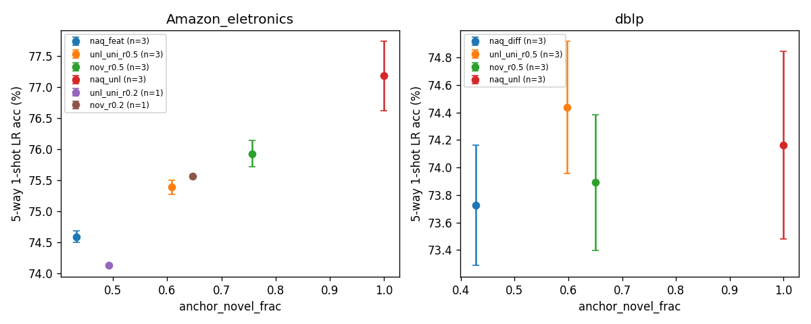

# T06 summary — label-scarce setting (r = base label ratio) and novelty anchoring

† naq_unl = r=1.0 분석용 상한 (레이블 없음 = novel 구조 이용). NaQ-best는 레이블을 쓰지 않아 r과 무관 (T03/T04 재사용).

## 1. A 요약

| dataset | r | U: hidden base / valid / test | AUROC sgc / raw | A_nov novel frac | novel cls covered | gini |
|---|---|---|---|---|---|---|
| Amazon_eletronics | 0.5 | 0.393 / 0.271 / 0.336 | 0.713 / 0.784 | 0.758 | 1.000 | 0.195 |
| Amazon_eletronics | 0.2 | 0.509 / 0.219 / 0.272 | 0.712 / 0.780 | 0.648 | 1.000 | 0.175 |
| dblp | 0.5 | 0.405 / 0.259 / 0.337 | 0.570 / 0.567 | 0.644 | 1.000 | 0.230 |
| dblp | 0.2 | 0.521 / 0.208 / 0.271 | 0.568 / 0.563 | 0.523 | 1.000 | 0.225 |

## 2. 결과 (dataset × arm × seed)

| dataset | arm | seed | 1s LR | 5s LR | q_purity | anchor_novel_frac | anchor_ent | best ep |
|---|---|---|---|---|---|---|---|---|
| Amazon_eletronics | naq_feat | 0 | 74.58 | 87.44 | 0.646 | 0.432 | 0.971 | 4000 |
| Amazon_eletronics | naq_feat | 1 | 74.69 | 87.44 | 0.649 | 0.434 | 0.970 | 4000 |
| Amazon_eletronics | naq_feat | 2 | 74.50 | 87.40 | 0.647 | 0.431 | 0.968 | 3000 |
| Amazon_eletronics | unl_uni_r0.5 | 0 | 75.41 | 87.83 | 0.639 | 0.607 | 0.961 | 3750 |
| Amazon_eletronics | unl_uni_r0.5 | 1 | 75.26 | 87.85 | 0.638 | 0.612 | 0.963 | 4000 |
| Amazon_eletronics | unl_uni_r0.5 | 2 | 75.49 | 87.88 | 0.639 | 0.606 | 0.961 | 4000 |
| Amazon_eletronics | nov_r0.5 | 0 | 76.06 | 88.24 | 0.605 | 0.757 | 0.920 | 4000 |
| Amazon_eletronics | nov_r0.5 | 1 | 76.03 | 88.48 | 0.606 | 0.759 | 0.921 | 4000 |
| Amazon_eletronics | nov_r0.5 | 2 | 75.69 | 88.55 | 0.607 | 0.753 | 0.923 | 4000 |
| Amazon_eletronics | naq_unl † | 0 | 77.72 | 88.78 | 0.611 | 1.000 | 0.820 | 4000 |
| Amazon_eletronics | naq_unl † | 1 | 77.19 | 88.75 | 0.615 | 1.000 | 0.821 | 4000 |
| Amazon_eletronics | naq_unl † | 2 | 76.62 | 88.38 | 0.612 | 1.000 | 0.820 | 3750 |
| Amazon_eletronics | unl_uni_r0.2 | 0 | 74.12 | 87.19 | 0.641 | 0.492 | 0.969 | 3750 |
| Amazon_eletronics | nov_r0.2 | 0 | 75.56 | 88.37 | 0.599 | 0.647 | 0.942 | 3750 |
| dblp | naq_diff | 0 | 73.28 | 82.35 | 0.292 | 0.427 | 0.967 | 750 |
| dblp | naq_diff | 1 | 74.15 | 82.90 | 0.294 | 0.425 | 0.967 | 3750 |
| dblp | naq_diff | 2 | 73.75 | 83.13 | 0.292 | 0.430 | 0.967 | 4000 |
| dblp | unl_uni_r0.5 | 0 | 74.82 | 83.25 | 0.296 | 0.598 | 0.954 | 3750 |
| dblp | unl_uni_r0.5 | 1 | 74.59 | 83.33 | 0.298 | 0.595 | 0.954 | 3250 |
| dblp | unl_uni_r0.5 | 2 | 73.90 | 82.42 | 0.298 | 0.599 | 0.954 | 750 |
| dblp | nov_r0.5 | 0 | 73.34 | 83.25 | 0.339 | 0.651 | 0.944 | 3750 |
| dblp | nov_r0.5 | 1 | 74.04 | 82.88 | 0.343 | 0.652 | 0.943 | 750 |
| dblp | nov_r0.5 | 2 | 74.30 | 82.82 | 0.338 | 0.647 | 0.944 | 500 |
| dblp | naq_unl † | 0 | 74.61 | 83.46 | 0.309 | 1.000 | 0.789 | 2250 |
| dblp | naq_unl † | 1 | 74.50 | 83.15 | 0.308 | 1.000 | 0.787 | 2750 |
| dblp | naq_unl † | 2 | 73.38 | 82.82 | 0.302 | 1.000 | 0.788 | 3000 |

## 3. 짝지은 차이 (같은 seed)

| dataset | 비교 | shot | s0 | s1 | s2 | 평균 | 표준편차 | 음수/양수 |
|---|---|---|---|---|---|---|---|---|
| Amazon_eletronics | unl_uni_r0.5 − naq_feat | 1s | +0.83 | +0.58 | +0.99 | +0.80 | 0.20 | 0/3 |
| Amazon_eletronics | unl_uni_r0.5 − naq_feat | 5s | +0.39 | +0.41 | +0.47 | +0.42 | 0.04 | 0/3 |
| Amazon_eletronics | nov_r0.5 − naq_feat | 1s | +1.48 | +1.35 | +1.19 | +1.34 | 0.15 | 0/3 |
| Amazon_eletronics | nov_r0.5 − naq_feat | 5s | +0.81 | +1.04 | +1.15 | +1.00 | 0.18 | 0/3 |
| Amazon_eletronics | nov_r0.5 − unl_uni_r0.5 | 1s | +0.65 | +0.77 | +0.20 | +0.54 | 0.30 | 0/3 |
| Amazon_eletronics | nov_r0.5 − unl_uni_r0.5 | 5s | +0.42 | +0.63 | +0.68 | +0.58 | 0.14 | 0/3 |
| Amazon_eletronics | naq_unl − naq_feat † | 1s | +3.15 | +2.50 | +2.12 | +2.59 | 0.52 | 0/3 |
| Amazon_eletronics | naq_unl − naq_feat † | 5s | +1.34 | +1.31 | +0.97 | +1.21 | 0.20 | 0/3 |
| Amazon_eletronics | unl_uni_r0.2 − naq_feat | 1s | -0.45 | - | - | -0.45 | nan | 1/0 |
| Amazon_eletronics | unl_uni_r0.2 − naq_feat | 5s | -0.24 | - | - | -0.24 | nan | 1/0 |
| Amazon_eletronics | nov_r0.2 − naq_feat | 1s | +0.99 | - | - | +0.99 | nan | 0/1 |
| Amazon_eletronics | nov_r0.2 − naq_feat | 5s | +0.94 | - | - | +0.94 | nan | 0/1 |
| dblp | unl_uni_r0.5 − naq_diff | 1s | +1.55 | +0.44 | +0.15 | +0.71 | 0.74 | 0/3 |
| dblp | unl_uni_r0.5 − naq_diff | 5s | +0.91 | +0.43 | -0.72 | +0.21 | 0.84 | 1/2 |
| dblp | nov_r0.5 − naq_diff | 1s | +0.06 | -0.11 | +0.55 | +0.17 | 0.34 | 1/2 |
| dblp | nov_r0.5 − naq_diff | 5s | +0.91 | -0.02 | -0.31 | +0.19 | 0.64 | 2/1 |
| dblp | nov_r0.5 − unl_uni_r0.5 | 1s | -1.48 | -0.55 | +0.39 | -0.55 | 0.94 | 2/1 |
| dblp | nov_r0.5 − unl_uni_r0.5 | 5s | +0.00 | -0.45 | +0.40 | -0.02 | 0.43 | 1/1 |
| dblp | naq_unl − naq_diff † | 1s | +1.33 | +0.35 | -0.38 | +0.44 | 0.86 | 1/2 |
| dblp | naq_unl − naq_diff † | 5s | +1.11 | +0.25 | -0.31 | +0.35 | 0.72 | 1/2 |

## 4. 회수율 R = (nov_r0.5 − NaQ-best) / (naq_unl − NaQ-best), seed 평균 차이로 계산 (1s)

| dataset | nov − best | naq_unl − best † | R | 사용 seed |
|---|---|---|---|---|
| Amazon_eletronics | +1.34 | +2.59 | 0.52 | nov [0, 1, 2], naq_unl [0, 1, 2] |
| dblp | +0.17 | +0.44 | 0.38 | nov [0, 1, 2], naq_unl [0, 1, 2] |

## 5. G6 계산값 (판정은 사람이 한다)

- eletronics: mean(nov_r0.5 − naq_feat) = +1.34; seed별 s0 +1.48, s1 +1.35, s2 +1.19; 양수 3/3 (기준: ≥ +1.0, 3개 모두 양수)
- dblp: mean(nov_r0.5 − naq_diff) = +0.17 (기준: ≥ −0.5)

## 6. 사전 등록 대조표 (계산값만)

| ID | 기준 | 계산값 |
|---|---|---|
| R1 | AUROC ≥ .65 (두 데이터셋, r=0.5) | elec 0.713, dblp 0.570 (sgc, 사용 점수) |
| R2 | eletronics A_nov novel 비율 ≥ .70 | 0.758 |
| R3 | elec unl_uni_r0.5 − NaQ-best ∈ [+0.2, +1.6] | +0.80 (seed 평균) |
| R4 | G6 eletronics 조건 | 평균 +1.34, 양수 3/3 |
| R5 | elec mean(nov − unl_uni) > 0 | +0.54 |
| R6 | G6 dblp 조건 | +0.17 |
| R7 | elec seed 평균 NaQ < unl_uni < nov < naq_unl | 74.59 / 75.39 / 75.93 / 77.18 |
| R8 | elec s0: (unl_uni_r0.2 − NaQ) < (unl_uni_r0.5 − NaQ) | -0.45 vs +0.83 |

NaQ-best·naq_unl의 seed 평균은 사용 가능한 seed 전체(NaQ-best 0–2, naq_unl 0–2)로 계산.

