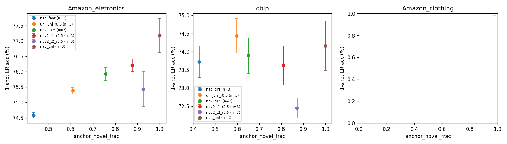
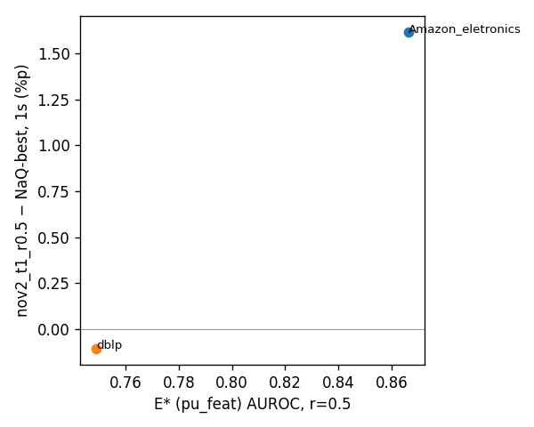

# T07 summary — PU novelty estimator, proportional anchoring, mixing

† naq_unl / r=1.0: 표준 설정에서는 '레이블 없음 = novel'이라 추정이 자명해짐 (분석용). ‡ mix_alt는 L의 레이블로 지도 에피소드를 씀 (NaQ보다 정보량 많음).

## 1. A 요약 (상세: results/T07A_estimators.md). E* = `pu_feat`

| dataset | r | cent_sgc | cent_raw | msp | pu_feat | pu_struct | pu_both | best | E* τ1 / τ2 기대 novel 비율 | T06 하드 컷 |
|---|---|---|---|---|---|---|---|---|---|---|
| Amazon_eletronics | 0.5 | 0.713 | 0.784 | 0.759 | 0.867 | 0.753 | 0.706 | pu_feat | 0.877 / 0.924 | 0.758 |
| Amazon_eletronics | 0.2 | 0.712 | 0.780 | 0.743 | 0.837 | 0.683 | 0.645 | pu_feat | 0.802 / 0.867 | 0.648 |
| dblp | 0.5 | 0.570 | 0.567 | 0.610 | 0.749 | 0.764 | 0.677 | pu_struct | 0.811 / 0.871 | 0.644 |
| dblp | 0.2 | 0.568 | 0.563 | 0.613 | 0.711 | 0.718 | 0.617 | pu_struct | 0.710 / 0.786 | 0.523 |
| Amazon_clothing | 0.5 | 0.707 | 0.720 | 0.763 | 0.909 | 0.870 | 0.780 | pu_feat | 0.933 / 0.958 | 0.836 |
| Amazon_clothing | 0.2 | 0.706 | 0.716 | 0.758 | 0.886 | 0.804 | 0.700 | pu_feat | 0.888 / 0.925 | 0.751 |
| mean r=0.5 | | 0.663 | 0.690 | 0.711 | 0.841 | 0.796 | 0.721 | | | |

PU 보정 절대 오차 (r=0.5): Amazon_eletronics pu_feat 0.263, pu_struct 0.067, pu_both 0.191; dblp pu_feat 0.396, pu_struct 0.232, pu_both 0.067; Amazon_clothing pu_feat 0.241, pu_struct 0.060, pu_both 0.163

## 2. B 결과

| dataset | arm | seed | 1s LR | 5s LR | q_purity | anchor_novel_frac | anchor_ent | best ep |
|---|---|---|---|---|---|---|---|---|
| Amazon_eletronics | naq_feat | 0 | 74.58 | 87.44 | 0.646 | 0.432 | 0.971 | 4000 |
| Amazon_eletronics | naq_feat | 1 | 74.69 | 87.44 | 0.649 | 0.434 | 0.970 | 4000 |
| Amazon_eletronics | naq_feat | 2 | 74.50 | 87.40 | 0.647 | 0.431 | 0.968 | 3000 |
| Amazon_eletronics | nov_r0.5 | 0 | 76.06 | 88.24 | 0.605 | 0.757 | 0.920 | 4000 |
| Amazon_eletronics | nov_r0.5 | 1 | 76.03 | 88.48 | 0.606 | 0.759 | 0.921 | 4000 |
| Amazon_eletronics | nov_r0.5 | 2 | 75.69 | 88.55 | 0.607 | 0.753 | 0.923 | 4000 |
| Amazon_eletronics | unl_uni_r0.5 | 0 | 75.41 | 87.83 | 0.639 | 0.607 | 0.961 | 3750 |
| Amazon_eletronics | unl_uni_r0.5 | 1 | 75.26 | 87.85 | 0.638 | 0.612 | 0.963 | 4000 |
| Amazon_eletronics | unl_uni_r0.5 | 2 | 75.49 | 87.88 | 0.639 | 0.606 | 0.961 | 4000 |
| Amazon_eletronics | nov2_t1_r0.5 | 0 | 75.96 | 88.23 | 0.665 | 0.876 | 0.869 | 3000 |
| Amazon_eletronics | nov2_t1_r0.5 | 1 | 76.31 | 88.20 | 0.671 | 0.876 | 0.869 | 4000 |
| Amazon_eletronics | nov2_t1_r0.5 | 2 | 76.33 | 88.22 | 0.669 | 0.879 | 0.868 | 3500 |
| Amazon_eletronics | nov2_t2_r0.5 | 0 | 76.09 | 87.98 | 0.696 | 0.926 | 0.826 | 3250 |
| Amazon_eletronics | nov2_t2_r0.5 | 1 | 75.10 | 87.56 | 0.694 | 0.924 | 0.827 | 3250 |
| Amazon_eletronics | nov2_t2_r0.5 | 2 | 75.11 | 87.79 | 0.697 | 0.925 | 0.827 | 4000 |
| Amazon_eletronics | mix_alt_r0.5 ‡ | 0 | 76.36 | 87.89 | 0.767 | 0.621 | 0.954 | 4000 |
| Amazon_eletronics | mix_alt_r0.5 ‡ | 1 | 76.24 | 88.02 | 0.772 | 0.603 | 0.956 | 4000 |
| Amazon_eletronics | naq_unl † | 0 | 77.72 | 88.78 | 0.611 | 1.000 | 0.820 | 4000 |
| Amazon_eletronics | naq_unl † | 1 | 77.19 | 88.75 | 0.615 | 1.000 | 0.821 | 4000 |
| Amazon_eletronics | naq_unl † | 2 | 76.62 | 88.38 | 0.612 | 1.000 | 0.820 | 3750 |
| dblp | naq_diff | 0 | 73.28 | 82.35 | 0.292 | 0.427 | 0.967 | 750 |
| dblp | naq_diff | 1 | 74.15 | 82.90 | 0.294 | 0.425 | 0.967 | 3750 |
| dblp | naq_diff | 2 | 73.75 | 83.13 | 0.292 | 0.430 | 0.967 | 4000 |
| dblp | nov_r0.5 | 0 | 73.34 | 83.25 | 0.339 | 0.651 | 0.944 | 3750 |
| dblp | nov_r0.5 | 1 | 74.04 | 82.88 | 0.343 | 0.652 | 0.943 | 750 |
| dblp | nov_r0.5 | 2 | 74.30 | 82.82 | 0.338 | 0.647 | 0.944 | 500 |
| dblp | unl_uni_r0.5 | 0 | 74.82 | 83.25 | 0.296 | 0.598 | 0.954 | 3750 |
| dblp | unl_uni_r0.5 | 1 | 74.59 | 83.33 | 0.298 | 0.595 | 0.954 | 3250 |
| dblp | unl_uni_r0.5 | 2 | 73.90 | 82.42 | 0.298 | 0.599 | 0.954 | 750 |
| dblp | nov2_t1_r0.5 | 0 | 73.12 | 83.25 | 0.381 | 0.807 | 0.877 | 3750 |
| dblp | nov2_t1_r0.5 | 1 | 73.56 | 83.05 | 0.381 | 0.812 | 0.875 | 2000 |
| dblp | nov2_t1_r0.5 | 2 | 74.17 | 82.78 | 0.381 | 0.808 | 0.877 | 750 |
| dblp | nov2_t2_r0.5 | 0 | 72.33 | 82.59 | 0.456 | 0.871 | 0.826 | 2250 |
| dblp | nov2_t2_r0.5 | 1 | 72.25 | 82.64 | 0.455 | 0.869 | 0.826 | 2750 |
| dblp | nov2_t2_r0.5 | 2 | 72.75 | 82.22 | 0.454 | 0.872 | 0.826 | 1000 |
| dblp | mix_alt_r0.5 ‡ | 0 | 76.86 | 83.84 | 0.570 | 0.569 | 0.957 | 4000 |
| dblp | mix_alt_r0.5 ‡ | 1 | 75.86 | 83.42 | 0.576 | 0.565 | 0.958 | 3750 |
| dblp | naq_unl † | 0 | 74.61 | 83.46 | 0.309 | 1.000 | 0.789 | 2250 |
| dblp | naq_unl † | 1 | 74.50 | 83.15 | 0.308 | 1.000 | 0.787 | 2750 |
| dblp | naq_unl † | 2 | 73.38 | 82.82 | 0.302 | 1.000 | 0.788 | 3000 |

## 3. 짝지은 차이 (같은 seed)

| dataset | 비교 | shot | s0 | s1 | s2 | 평균 | sd | 음수/양수 |
|---|---|---|---|---|---|---|---|---|
| Amazon_eletronics | nov2_t1_r0.5 − naq_feat | 1s | +1.39 | +1.62 | +1.83 | +1.62 | 0.22 | 0/3 |
| Amazon_eletronics | nov2_t1_r0.5 − naq_feat | 5s | +0.80 | +0.77 | +0.81 | +0.79 | 0.03 | 0/3 |
| Amazon_eletronics | nov2_t2_r0.5 − naq_feat | 1s | +1.51 | +0.41 | +0.61 | +0.84 | 0.59 | 0/3 |
| Amazon_eletronics | nov2_t2_r0.5 − naq_feat | 5s | +0.55 | +0.12 | +0.39 | +0.35 | 0.22 | 0/3 |
| Amazon_eletronics | nov2_t1_r0.5 − nov2_t2_r0.5 | 1s | -0.12 | +1.21 | +1.23 | +0.77 | 0.77 | 1/2 |
| Amazon_eletronics | nov2_t1_r0.5 − nov2_t2_r0.5 | 5s | +0.25 | +0.64 | +0.42 | +0.44 | 0.20 | 0/3 |
| Amazon_eletronics | nov2_t1_r0.5 − nov_r0.5 | 1s | -0.10 | +0.28 | +0.65 | +0.28 | 0.37 | 1/2 |
| Amazon_eletronics | nov2_t1_r0.5 − nov_r0.5 | 5s | -0.01 | -0.28 | -0.34 | -0.21 | 0.18 | 3/0 |
| Amazon_eletronics | mix_alt_r0.5 − nov2_t1_r0.5 | 1s | +0.40 | -0.07 | - | +0.17 | 0.33 | 1/1 |
| Amazon_eletronics | mix_alt_r0.5 − nov2_t1_r0.5 | 5s | -0.34 | -0.18 | - | -0.26 | 0.11 | 2/0 |
| Amazon_eletronics | mix_alt_r0.5 − naq_feat | 1s | +1.79 | +1.56 | - | +1.67 | 0.17 | 0/2 |
| Amazon_eletronics | mix_alt_r0.5 − naq_feat | 5s | +0.46 | +0.58 | - | +0.52 | 0.08 | 0/2 |
| Amazon_eletronics | naq_unl − naq_feat | 1s | +3.15 | +2.50 | +2.12 | +2.59 | 0.52 | 0/3 |
| Amazon_eletronics | naq_unl − naq_feat | 5s | +1.34 | +1.31 | +0.97 | +1.21 | 0.20 | 0/3 |
| dblp | nov2_t1_r0.5 − naq_diff | 1s | -0.16 | -0.59 | +0.42 | -0.11 | 0.51 | 2/1 |
| dblp | nov2_t1_r0.5 − naq_diff | 5s | +0.91 | +0.15 | -0.36 | +0.23 | 0.64 | 1/2 |
| dblp | nov2_t2_r0.5 − naq_diff | 1s | -0.94 | -1.91 | -1.00 | -1.28 | 0.54 | 3/0 |
| dblp | nov2_t2_r0.5 − naq_diff | 5s | +0.24 | -0.26 | -0.91 | -0.31 | 0.58 | 2/1 |
| dblp | nov2_t1_r0.5 − nov2_t2_r0.5 | 1s | +0.79 | +1.31 | +1.42 | +1.17 | 0.34 | 0/3 |
| dblp | nov2_t1_r0.5 − nov2_t2_r0.5 | 5s | +0.66 | +0.41 | +0.56 | +0.54 | 0.13 | 0/3 |
| dblp | nov2_t1_r0.5 − nov_r0.5 | 1s | -0.22 | -0.48 | -0.12 | -0.27 | 0.19 | 3/0 |
| dblp | nov2_t1_r0.5 − nov_r0.5 | 5s | +0.00 | +0.17 | -0.04 | +0.04 | 0.11 | 1/1 |
| dblp | mix_alt_r0.5 − nov2_t1_r0.5 | 1s | +3.74 | +2.30 | - | +3.02 | 1.02 | 0/2 |
| dblp | mix_alt_r0.5 − nov2_t1_r0.5 | 5s | +0.58 | +0.38 | - | +0.48 | 0.14 | 0/2 |
| dblp | mix_alt_r0.5 − naq_diff | 1s | +3.58 | +1.71 | - | +2.65 | 1.33 | 0/2 |
| dblp | mix_alt_r0.5 − naq_diff | 5s | +1.49 | +0.52 | - | +1.00 | 0.68 | 0/2 |
| dblp | naq_unl − naq_diff | 1s | +1.33 | +0.35 | -0.38 | +0.44 | 0.86 | 1/2 |
| dblp | naq_unl − naq_diff | 5s | +1.11 | +0.25 | -0.31 | +0.35 | 0.72 | 1/2 |

## 4. 회수율 (nov2_t1_r0.5 − NaQ) / (naq_unl − NaQ), seed 평균 차이, 1s

- Amazon_eletronics: +1.62 / +2.59 = 0.62
- dblp: -0.11 / +0.44 = -0.24
- Amazon_clothing: - / - = -

 

## 5. 메커니즘: best-checkpoint 임베딩의 k-means NMI (test / base 클래스 노드, 레이블은 분석용)

| dataset | run | NMI_test | NMI_base | ΔNMI_test vs NaQ | ΔNMI_base vs NaQ |
|---|---|---|---|---|---|
| Amazon_eletronics | NaQ (naq_feat, P3) | 0.6161 | 0.6584 | +0.0000 | +0.0000 |
| Amazon_eletronics | nov2_t1 | 0.6328 | 0.6208 | +0.0167 | -0.0375 |
| Amazon_eletronics | nov2_t2 | 0.6262 | 0.6026 | +0.0101 | -0.0558 |
| Amazon_eletronics | mix_alt ‡ | 0.6268 | 0.6864 | +0.0107 | +0.0280 |
| Amazon_eletronics | naq_unl † | 0.6479 | 0.6140 | +0.0318 | -0.0443 |
| dblp | NaQ (naq_diff, P3) | 0.5589 | 0.5396 | +0.0000 | +0.0000 |
| dblp | nov2_t1 | 0.5729 | 0.5420 | +0.0141 | +0.0025 |
| dblp | nov2_t2 | 0.5668 | 0.5299 | +0.0079 | -0.0097 |
| dblp | mix_alt ‡ | 0.5896 | 0.5845 | +0.0307 | +0.0450 |

## 6. G7 계산값 (판정은 사람이 한다)

- G7-a: E* (pu_feat)의 dblp AUROC (r=0.5) = 0.749 (기준 ≥ 0.65)
- G7-b: nov2_t1_r0.5 − NaQ-best (1s) — Amazon_eletronics: 평균 +1.62, 양수 3/3; dblp: 평균 -0.11, 양수 1/3 (기준: 평균 ≥ +1.0, seed 모두 양수; clothing은 seed 2개)

## 7. 사전 등록 대조표 (계산값만)

| ID | 기준 | 계산값 |
|---|---|---|
| S1 | r=0.5 pu_both − cent_sgc AUROC ≥ +0.05 (3개 중 ≥2) | Amazon_clothing +0.073, Amazon_eletronics -0.007, dblp +0.107 |
| S2 | E* dblp AUROC (r=0.5) ≥ 0.65 | 0.749 |
| S3 | elec nov2_t1_r0.5 − NaQ ≥ +1.3 | +1.62 |
| S4 | elec nov2_t2 − nov2_t1 > 0 | -0.77 |
| S5 | dblp nov2_t1 − NaQ (S2 성립 시 ≥ +0.5, 아니면 abs < 0.7) | -0.11 (S2 계산값 0.749) |
| S6 | mix_alt − NaQ ≥ 0 (둘 다), elec mix_alt − nov2_t1 ∈ [−0.5, +1.5] | elec +1.67, dblp +2.65; elec mix − nov2_t1 +0.17 |
| S7 | abs((nov2_t1_r1.0 − NaQ) − (naq_unl − NaQ)) ≤ 0.7 (elec) | nov2_t1_r1.0 - vs naq_unl +2.59 (같은 seed 기준) |
| S8 | elec nov2_t1_r0.2 − NaQ ≥ +0.7 (seed 2개) | - |
| S9 | clothing nov2_t1_r0.5 − naq_feat ≥ +1.0, 모두 양수 | -; seed별  |
| S10 | elec NMI_test NaQ < nov2_t1 < naq_unl, abs(ΔNMI_base) < abs(ΔNMI_test) | NMI_test NaQ / nov2_t1 / naq_unl = 0.6161 / 0.6328 / 0.6479; |ΔNMI_base| 0.0375 vs |ΔNMI_test| 0.0167 (nov2_t1 vs NaQ) |
