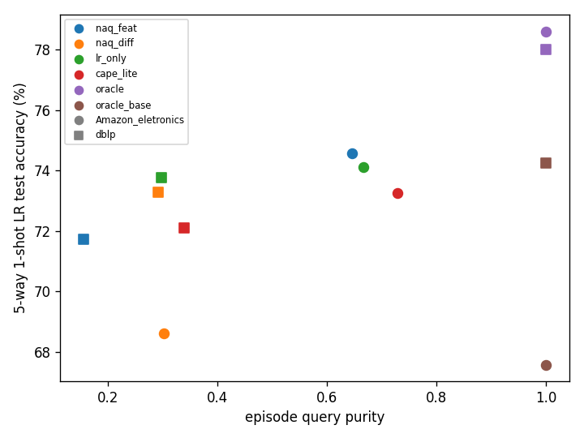

# CaPE validation summary (T03)

1-shot LR test accuracy (%) unless noted. seed 0, 500 test tasks; differences < 1.5%p are within noise.

## (a) Exp B

| dataset | arm | q_purity | way_coll | q_overlap | anchor_uniq | anchor_ent | base/valid/test anchors | 1s LR | 5s LR | 1s proto | best ep / total | time (s) |
|---|---|---|---|---|---|---|---|---|---|---|---|---|
| Amazon_eletronics | naq_feat | 0.646 | 0.031 | 0.001 | 0.798 | 0.971 | 0.57/0.19/0.24 | 74.58 ± 1.12 | 87.44 ± 0.75 | 70.28 | 4000 / 4000 | 255 |
| Amazon_eletronics | naq_diff | 0.302 | 0.031 | 0.186 | 0.798 | 0.971 | 0.57/0.19/0.24 | 68.61 ± 1.18 | 84.83 ± 0.83 | 63.76 | 3500 / 4000 | 255 |
| Amazon_eletronics | lr_only | 0.666 | 0.031 | 0.001 | 0.798 | 0.971 | 0.57/0.19/0.24 | 74.11 ± 1.15 | 87.26 ± 0.74 | 69.45 | 3750 / 4000 | 255 |
| Amazon_eletronics | cape_lite | 0.728 | 0.028 | 0.000 | 0.726 | 0.953 | 0.58/0.18/0.24 | 73.26 ± 1.19 | 86.72 ± 0.77 | 68.20 | 3250 / 4000 | 256 |
| Amazon_eletronics | oracle | 1.000 | 0.000 | 0.000 | 0.796 | 0.972 | 0.56/0.19/0.24 | 78.61 ± 1.11 | 89.69 ± 0.70 | 74.37 | 4000 / 4000 | 256 |
| Amazon_eletronics | oracle_base | 1.000 | 0.000 | 0.000 | 0.679 | 0.851 | 1.00/0.00/0.00 | 67.58 ± 1.20 | 84.31 ± 0.82 | 62.77 | 2000 / 4000 | 256 |
| dblp | naq_feat | 0.156 | 0.041 | 0.004 | 0.792 | 0.967 | 0.57/0.19/0.24 | 71.72 ± 1.19 | 81.35 ± 1.00 | 68.59 | 1750 / 4000 | 256 |
| dblp | naq_diff | 0.292 | 0.041 | 0.001 | 0.792 | 0.967 | 0.57/0.19/0.24 | 73.28 ± 1.20 | 82.35 ± 0.97 | 69.28 | 750 / 4000 | 255 |
| dblp | lr_only | 0.298 | 0.041 | 0.001 | 0.792 | 0.967 | 0.57/0.19/0.24 | 73.77 ± 1.17 | 82.40 ± 0.98 | 69.53 | 2000 / 4000 | 255 |
| dblp | cape_lite | 0.339 | 0.037 | 0.000 | 0.718 | 0.971 | 0.59/0.17/0.23 | 72.10 ± 1.18 | 82.66 ± 0.96 | 67.36 | 4000 / 4000 | 256 |
| dblp | oracle | 1.000 | 0.000 | 0.000 | 0.787 | 0.967 | 0.57/0.19/0.24 | 78.00 ± 1.12 | 84.44 ± 0.93 | 75.59 | 2750 / 4000 | 256 |
| dblp | oracle_base | 1.000 | 0.000 | 0.000 | 0.668 | 0.862 | 1.00/0.00/0.00 | 74.25 ± 1.16 | 82.33 ± 0.95 | 70.67 | 4000 / 4000 | 256 |

## (b) Gates

### G1 (from results/expA)

| dataset | R* | Δ_lr | Spearman | Δ≥0.03 | ρ≥0.3 |
|---|---|---|---|---|---|
| Amazon_clothing | sgc | +0.015 | 0.418 | FAIL | PASS |
| Amazon_eletronics | raw | +0.016 | 0.505 | FAIL | PASS |
| dblp | sgc | +0.000 | 0.215 | FAIL | FAIL |

G1 Δ 조건 통과 0/3 (기준 ≥2)

### G2 / G3

| dataset | NaQ-best | NaQ-best acc | oracle − NaQ-best | cape_lite − NaQ-best | (oracle − NaQ-best)/3 | cape_lite ≥ NaQ-best − 0.5 |
|---|---|---|---|---|---|---|
| Amazon_eletronics | naq_feat | 74.58 | +4.03 | -1.32 (잡음 범위) | +1.34 | FAIL |
| dblp | naq_diff | 73.28 | +4.73 | -1.18 (잡음 범위) | +1.58 | FAIL |
| mean | | | +4.38 | -1.25 (잡음 범위) | +1.46 | |

- G2: mean(oracle − NaQ-best) = +4.38 (기준 ≥ +2.0) → PASS
- G3: mean(cape_lite − NaQ-best) = -1.25 vs mean(oracle − NaQ-best)/3 = +1.46 → FAIL; per-dataset ≥ −0.5: FAIL → G3 FAIL

### 보조 비교 (게이트 아님)

| dataset | lr_only − NaQ-best | cape_lite − lr_only | oracle_base − NaQ-best | oracle − oracle_base |
|---|---|---|---|---|
| Amazon_eletronics | -0.47 (잡음 범위) | -0.85 (잡음 범위) | -6.99 | +11.02 |
| dblp | +0.49 (잡음 범위) | -1.67 | +0.98 (잡음 범위) | +3.75 |
| mean | +0.01 (잡음 범위) | -1.26 (잡음 범위) | -3.01 | +7.39 |

oracle_base는 G2·G3 계산에 쓰지 않았다.

## (c) 재현 점검 (NaQ Table 15/16, ProtoNet LR probing)

| dataset | arm | ours 1s | paper 1s | Δ1s | ours 5s | paper 5s | Δ5s |
|---|---|---|---|---|---|---|---|
| Amazon_eletronics | naq_feat | 74.58 | 76.46 | -1.88 | 87.44 | 88.72 | -1.28 |
| Amazon_eletronics | naq_diff | 68.61 | 68.56 | +0.05 | 84.83 | 84.88 | -0.05 |
| dblp | naq_feat | 71.72 | 71.38 | +0.34 | 81.35 | 82.34 | -0.99 |
| dblp | naq_diff | 73.28 | 73.89 | -0.61 | 82.35 | 82.24 | +0.11 |

Amazon_eletronics: feat − diff = ours +5.96, paper +7.90

dblp: feat − diff = ours -1.56, paper -2.51

## (e) 과소학습 점검

- best 에피소드가 마지막 20%(> 3200)에 있는 run: 7/12 (oracle_base 제외 6/10)
- **학습 부족 가능성**
- Amazon_eletronics/naq_feat:4000, Amazon_eletronics/naq_diff:3500, Amazon_eletronics/lr_only:3750, Amazon_eletronics/cape_lite:3250, Amazon_eletronics/oracle:4000, Amazon_eletronics/oracle_base:2000, dblp/naq_feat:1750, dblp/naq_diff:750, dblp/lr_only:2000, dblp/cape_lite:4000, dblp/oracle:2750, dblp/oracle_base:4000

## (d) 그림

